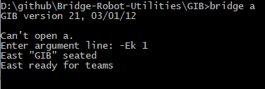
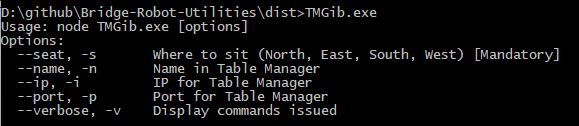
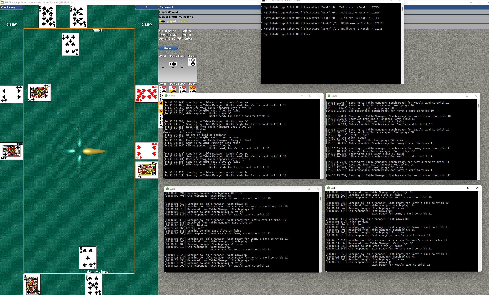

# Bridge-Robot-Utilities
Some utilities for arranging and displaying the result of matches between robots playing bridge.

# TMPbn2LinVG 
Used for translating PBN-files from [Bridge Moniteur](http://www.wbridge5.com/bm.htm) - a table manager - into lin-files, that can be viewed in [NetBridgeVu.exe] (https://www.bridgebase.com/intro/installation_guide_for_bbo.php).

Each match will be split in 32 board sections.

# TMGib
Enables GIB to be called from a table monitor. Both Table Monitors are supported

## Installation
You can clone this repository or download a release with executables

You will have to copy the GIB-executable as it is not included in this repository.

Just place it in a folder of your own choice - the program expects to find GIB in a subfolder called GIB (But you can change it by sending a parameter)

These files should be present in the GIB folder

- bridge.exe
- MB.TXT
- Comments.txt
- EVAL.DAT
- gib.ini

Test it works by writing:

```bridge a ```
then ```-Ek 1``` in argument line. 
Press enter and it will just move to next line. 
Now enter ```East "GIB" seated``` and if you get the response ```East ready for teams``` it should be ok.



Open a command prompt and navigate to the folder where you placed TMGib.exe.

Start your Table Monitor (Bridge Moniteur as example with Instant replay)

In the prompt you type TMGib and enter and should get something like this:



So enter

```TMGib -S North -n GIB```

to use in Bridge Moniteur as it default to port 2000 at the local machine

Repeat for number of bots

A nice little trick you can use is commands like

```start "North" /D . TMGib.exe -s North -n GIBNS```

that will start the program in a new window.

So it could look like this


When done playing you can see the result in TM, but there is also a PBN saved.

The PBN can be translated to Lin by downloading TMPbn2LinVG.exe from this repository.

TMGib supports the following command line parameters:

-  --seat, -s       Where to sit (North, East, South, West) [Mandatory]
-  --name, -n       Name in Table Manager - default GIB
-  --ip, -i         IP for Table Manager - default 127.0.0.1
-  --port, -p       Port for Table Manager - default 2000
-  --timing, -t     time (secs) for one GIB to play one board, on average - Default 60
-  --bidding, -b    Tell GIB to use sys.ns sys.ew as input - default False
-  --delay, -d      Delay between commands, default 100 ms
-  --gibdir, -g     Directory where to find GIB executables - default ./GIB
-  --simdecl, -m    number of deals to analyze to pick a play as declarer - default 50
-  --simdef, -e     number of deals to analyze to pick a play as defender - default 50
-  --verbose, -v    Display commands issued to GIB and other interesting logging - default False


# TMMediator
This program allows you to play with Blue Chip Bridge using Bridge Moniteur.

This program will listen on 4 ports and send it all to Bridge Moniteur, and send the response back to individual clients.

TMMediator is listening on ports 2001-2004 and you can follow the communication between the programs

Now Blue Chip can handle all 4 robots in the same program, or you can start 4 instances of Blue Chip (I did the first and that could explain the randomness was resulting in 0-0)

So just go to Network play and click on all 4 directions. You need to change port for North from 2000 to 2004 as 2000 is used by Bridge Moniteur.

# TMWbridge5

Lets WBridge5 be started and seated automatically, so a match needs no manual step.

WBridge5 can connect to a table manager on its own if you start it as

```cmd
Wbridge5.exe Autoconnect 2000
```

but it always announces itself with the seat `ANYPL` - "any player". It does not pick a seat, it
asks the table manager to give it one, and there is no way to tell it which: a third argument is
ignored, and the seat keys in WBRIDGE5.INI have no effect on this.

Bridge Moniteur assigns the first free seat, so Autoconnect works there. TMJob does not - it
expects `North`, `East`, `South` or `West` and answers `Illegal hand 'anypl' specified`, so
WBridge5 never gets seated.

TMWbridge5 sits between the two and fills in the seat. It listens on one port per seat, so the
port you point WBridge5 at decides where it sits:

```cmd
TMWbridge5 --exe "D:\Bridge\Robot\WBridge5\Wbridge5.exe" --dir D:\WB5
```

That listens on 2010-2013 for North, East, South and West, starts a WBridge5 for each seat in
`D:\WB5\North`, `D:\WB5\East` and so on, and stops them again when you stop it with Ctrl+C.
Leave out `--exe` to start the instances yourself, pointing each at the port for its seat
(`Wbridge5.exe Autoconnect 2012` sits South).

`--dir` is optional. WBridge5 only writes WBRIDGE5.INI back when you change a setting, so any number
of instances can share one folder - eight at once has been run without trouble. Use `--dir` when the
seats need *different* settings: WBRIDGE5.INI is where the bidding system is configured, so separate
folders are what let N/S and E/W play different systems.

The listening ports start at 2010 to stay clear of the table manager itself: TMJob uses 2000 for its
first table and **2001 for its second**, so the more obvious 2001-2004 would collide with a two-table
match. If something else already holds a port, TMWbridge5 says so and stops
(`Cannot listen on port 2010: EADDRINUSE`) rather than starting half a table - move the block with
`--firstport`.

A two-table match needs one TMWbridge5 per table, each with its own `--port` and `--firstport`,
because a table manager table is one port:

```cmd
TMWbridge5 --port 2000 --seats East,West  --firstport 2010 --exe "%WB5%"
TMWbridge5 --port 2001 --seats North,South --firstport 2012 --exe "%WB5%"
```

For a WBridge5 against WBridge5 match you also need `--name`, because every instance announces the
team name `WBridge5` and TMJob refuses two pairs with the same name:

```cmd
TMWbridge5 --name "WB5-NS,WB5-EW" --exe "D:\Bridge\Robot\WBridge5\Wbridge5.exe" --dir D:\WB5
```

Only the connect message is rewritten. Everything after it is passed through untouched in both
directions, so the table manager and WBridge5 talk to each other exactly as they would without it.

TMWbridge5 supports the following command line parameters:

-  --port, -p        Table manager port - default 2000
-  --ip, -i          Table manager IP - default 127.0.0.1
-  --firstport, -f   First port to listen on - default 2010
-  --seats, -s       Seats to serve, in port order - default North,East,South,West
-  --name, -n        Team name to announce. One name, or NS/EW comma separated. Default is to leave WBridge5's own name
-  --exe, -e         Path to Wbridge5.exe. When given, an instance is started per seat
-  --dir, -d         Base folder for the started instances; each seat runs in \<dir\>\\\<Seat\>
-  --verbose, -v     Log all traffic, both directions - default False

# TMPbn2DDS

This utility will take a pbn-file from Bridge Moniteur with instant replay and remove some non-standard lines, and rotate the deal from the replay, so the file can be opened in Double Dummy Solver, or Bridge Composer.

# printmatchashtml

Based on the output from TMPbn2DDS this utility will create an index file with the results from all boards and with a link to each Board played. The link is to a file called BEN.htm, and is expected to be produces using Bridge Composer (using the script FormatMatch and Save as HTML).

# TMPbn2Cleaner

Utility to clean a pbn-file for certain non-standard lines.

# CalculateMatch

Merges PBN-file from open and closed room into one new file for a match.

# MergePBNFiles
Scans a directory (optionally including subdirectories) and merge all PBN-files into one new PBN-file.
Started without arguments it asks for the folder, whether to include subfolders, and the output file name.
It reports boards that appear more than once - in the same file or in different files - with the file and board number of both: exact duplicates, rotated boards (hands, dealer and vulnerability all turned), and rotated deals with a different dealer or vulnerability. Nothing is removed; use ResetAndRenumberPBNBoards for that.
From the command line: `MergePBNFiles -d <folder> [-o All.PBN] [-r]`

# CountPBNBoards
Count the number of boards in a PBN-file

# ResetAndRenumberPBNBoards
Renumber all boards in a PBN-file; dealer and vulnerability are set from the new board number (1 = North/None, 2 = East/NS, ...). Incomplete deals (a hand without 13 cards, or a card dealt twice) are left out and reported. Duplicate deals, and deals that are just another deal rotated, are removed. Be aware that any play information is removed in the processing

# Split_PBN
Splits a played PBN-file by comparing each result with the par score (`OptimumScore` from the file, or looked up in `DatumScores.pkl`). It writes up to six files next to the input, named `<file.pbn>-<part>.pbn`, each only when it has boards:

- `db_making` - doubled contracts that made
- `db_not_making` - doubled contracts that went down (these boards also go to `disaster` or `OK_boards`)
- `disaster` - the NS score is more than 2000 away from par
- `OK_boards` - the rest
- `duplicates` - a deal's third and later copies (two are allowed, as Practice-Bidding-Scenarios writes each deal again rotated)
- `missing-DD` - boards with no par score in the file or in `DatumScores.pkl`

Started without arguments it asks for the file. From the command line: `Split_PBN <file.pbn> [DatumScores.pkl]` (the pickle defaults to `DatumScores.pkl` in the current folder).

# PBN2LinUI
A simple application, that converts a PBN-file to a LIN-file

# csvlin2pbn
Convert a csv-file from Danish Bridge federation to a .PBN-file

# ExtractLinks
Extract challenge match from BBO as PBN

# comparematchpbnashtml
Compare two matches (typical replay between robots) and present the result as html
Each deal is presented in the handviewer

# comparerobots
Select a PBN-file from each robot and create an HTML comparison report showing bidding and play results side-by-side with tricks, scores, IMP differences, and a final summary table

# listmatchpbnashtml
Merging multiple PBN-files with the same boards into one html-file, so it is possible to compare all results for a round in the same file
Each deal is presented in the handviewer.
The html-page is standalone and require no stylesheet or script

# PBN2LIN
Command-line utility to convert a PBN-file to LIN format. Output filename is optional (defaults to input filename with .lin extension)

# LIN2PBN
Command-line utility to convert a LIN-file to PBN format. Output filename is optional (defaults to input filename with .pbn extension)

# Lin2PBNUI
A simple application, that converts a LIN-file to a PBN-file

# DatumScores.pkl
The shared cache behind `AddDatumScoreToPBN`, `UpdateScore` and `Split_PBN`. It is keyed by the exact `[Deal "..."]` line and holds **only the deal's double-dummy table** — 20 trick counts, one per (declarer, denomination) in the order N/E/S/W × S/H/D/C/NT.

Par is not stored: it depends on the board's vulnerability (and a contract's score on the contract), so the tools compute `[OptimumScore]` and `[ParContract]` for each board from its own `[Vulnerable]`, with the double-dummy solver's par calculation, written the way BBA writes them (`NS 2H=; NS 3C=`, `W 1H+2`, `EW -100` with `EW 2SX-1`). That is what lets one entry serve the same deal at every vulnerability. Older pickles, which stored the par itself and so gave a deal that recurs at another vulnerability the wrong par, are still read — only their table is used. `ComputeDDTables` converts one to the current format.

# ExtractDatumScore
Adds the double-dummy tables a PBN-file already carries (its `[OptimumResultTable]`s) to `DatumScores.pkl`. Nothing is solved, so it is instant; boards without a complete table are counted, and `ComputeDatumScores` solves those.

```cmd
ExtractDatumScore.exe input.pbn DatumScores.pkl
```

Run with no arguments to pick the PBN in a dialog (the pickle is then `DatumScores.pkl` in the current folder).

# ComputeDDTables
Converts an old `DatumScores.pkl` (whose entries stored the par tags) to the current format: it double-dummy solves every entry that has no table yet (via endplay/DDS) and rewrites every entry as the table alone. On a current pickle it does nothing.

Solving is the expensive step (hours for a large pickle). It is **resumable**: worker processes checkpoint their progress (`dd_ckpt_*.pkl`), so an interrupted run continues where it left off, and the original pickle is backed up to `DatumScores.pkl.bak` and replaced atomically. Solving is done with a small number of worker processes (DDS already threads internally; override the default with the `DD_WORKERS` environment variable).

```cmd
python src/ComputeDDTables.py DatumScores.pkl
```

Not shipped as an executable (endplay's double-dummy solver is a developer-side, source-only step); run it from source.

# ComputeDatumScores
Double-dummy solves the deals of a PBN-file that `DatumScores.pkl` has no table for (e.g. a file of random deals) and adds their tables. Each distinct deal is solved once, however many boards share it.

Use this when `ExtractDatumScore` can't help because the file carries no tables. Afterwards `AddDatumScoreToPBN` can annotate the PBN from the now-populated pickle.

```cmd
python src/ComputeDatumScores.py input.pbn DatumScores.pkl
```

Like `ComputeDDTables`, this is the expensive one-time step (hours for a large file), resumable via worker checkpoints, and it backs up/rewrites the pickle atomically. Not shipped as an executable; run it from source.

# AddDatumScoreToPBN
Annotates a PBN-file from `DatumScores.pkl`, writing one output file. For every board it looks the deal's table up in the pickle and inserts `[OptimumScore]` and `[ParContract]` — computed for that board's own vulnerability — and the standard 20-row `[OptimumResultTable]`, grouped after the `[Deal]` tag.

It edits the file as text (not through endplay), so all other tags, comments, auctions and play lines are preserved byte-for-byte and non-standard board labels (e.g. `T1`) are kept. It streams one board at a time (handles multi-hundred-MB files), is idempotent (re-running replaces the tags it manages rather than duplicating them), and passes boards through unchanged when a deal is not in the pickle.

```cmd
python src/AddDatumScoreToPBN.py input.pbn DatumScores.pkl output.pbn
```

Run with no arguments for the file-picker GUI. Output filename defaults to `<input>-DD.pbn`.

# UpdateScore
Scores the auctions in a PBN-file from `DatumScores.pkl`, for boards bid by an engine that writes only the calls (for example Pidgin's `scripts/bid_pbn.py`). For every board with an `[Auction]` it works out the final contract and declarer from the auction and writes:

- `[Declarer]` and `[Contract]`, from the auction: the last bid, any double or redouble after it, and the first player of the declaring side to name the strain.
- `[Result]`, declarer's **double-dummy** tricks from the pickle's 20-cell table. Nothing is played.
- `[Score]`, that result scored for the contract and the declarer's vulnerability, from North-South's side (`NS -100`).
- `[OptimumScore]`, `[ParContract]` and `[OptimumResultTable]`, exactly as `AddDatumScoreToPBN` writes them.

These are the tags `Split_PBN` judges a board by, so the output can go straight into it. Like `AddDatumScoreToPBN` it edits the file as text: every other tag, note and comment is kept byte-for-byte, it streams one board at a time, and re-running replaces the tags it manages. A board without an `[Auction]` is copied unchanged. A board whose deal is not in the pickle (or has no double-dummy table there) gets its contract and declarer with an empty `[Result]` and `[Score]`, and `Split_PBN` then files it under `-missing-DD`.

```cmd
UpdateScore.exe bid.pbn DatumScores.pkl bid-scored.pbn
Split_PBN.exe bid-scored.pbn DatumScores.pkl
```

Without the second argument it uses `DatumScores.pkl` in the current folder; the output defaults to `<input>-scored.pbn`.

## Prebuilt DatumScores.pkl

A prebuilt `DatumScores.pkl` is attached to the GitHub release as **`DatumScores.zip`** (the raw pickle is too large to ship in the repo). It covers ~2.63M deals — the match/training data, the random deals and the Practice-Bidding-Scenarios deals of October 2026 — each with its double-dummy table. (A pickle from a release before the tricks-only format also stores par tags; the tools ignore those and use only the table.) To use it:

1. Download `DatumScores.zip` from the [latest release](https://github.com/ThorvaldAagaard/Bridge-Robot-Utilities/releases/latest).
2. Unzip it to get `DatumScores.pkl`.
3. Put `DatumScores.pkl` in the folder you run the tools from — `AddDatumScoreToPBN` (when no pickle path is given) and `Split_PBN` look for `DatumScores.pkl` in the current working directory.

You only need this if you want the shared datum-score/double-dummy cache; otherwise you can build it yourself with `ExtractDatumScore` (files that carry tables) and `ComputeDatumScores` (files that don't).

## Prebuilt board datasets

Two annotated board sets are attached to the GitHub release (zipped, as the raw files are hundreds of MB):

- **`TrainingDeals.zip`** — ~1.18M boards with bidding/play, each annotated with `OptimumScore`, `ParContract` and the 20-row `OptimumResultTable`.
- **`RandomDeals.zip`** — 1M random deals, each annotated with `OptimumScore`, `ParContract` and the `OptimumResultTable` (computed double-dummy).

Download from the [latest release](https://github.com/ThorvaldAagaard/Bridge-Robot-Utilities/releases/latest) and unzip to get the `.pbn`.

# PbnExtractBoards
Extracts unique boards from a PBN-file, removing duplicate deals and renumbering boards sequentially

# ProcessRobotReports
Files the match reports that arrive in a robot's report folder (for example `D:\RobotMatches\Eamon`) and keeps its board decks up to date - the work of opening each report, PbnExtractBoards, MergePBNFiles and ResetAndRenumberPBNBoards in one step.

It reads two kinds of report from the folder: Brill TMClient report zips (`BrillTM_*.zip`, with the match in `match.pbn`) and plain match PBNs (for example a RoboBridge table manager export). For each one it

1. saves the match in `Boards\<name>.matches` as `Brill_versus_<robot>_<label>_<start>_match.pbn`,
2. extracts its boards to `Boards\All-<name>.PBN\Extract_<match file>`,
3. moves the report to `Processed`,

and then merges every extract into `All.PBN` and renumbers it into `Ordered_All.PBN` (duplicate, rotated and incomplete deals left out; details in `merge.log`). The same pair is built per robot in `Boards\All-<name>.PBN\<robot>\`, so each robot has its own deck to replay. The extracts are merged in the order the matches were played, so a new match only adds boards at the end. The previous `All.PBN`/`Ordered_All.PBN` are kept as `.bak`.

`<name>` is the folder's name. The robot in a file name is the one in the player tags, not the one the match was named after - match names are often wrong (a match named `WB5_2_sep26_match21` was played against Lia) - and the `[Event]` tags are rewritten to agree.

A match already filed is not filed again (a zip is recognised by the start time in its name), and a match without an extract gets one, so running it again finishes whatever was left half done. Reports it cannot use are listed and left in place: zips that are not Brill TMClient reports, and older reports that hold only the per-seat `match/Board###_Room_Seat.pbn` files and no `match.pbn` (open those in Brill's Match Analysis and save the match by hand). A folder without the `Boards`/`Processed` layout gets it on the first run.

Started without arguments it asks for the folder, and whether to rename the matches already filed, and shows a summary at the end.
From the command line: `ProcessRobotReports <folder> [--dry-run] [--rename] [--merge] [--name <name>]`
- `--dry-run` lists what would be done.
- `--rename` also renames the matches already filed, with their extracts and the zips in `Processed`, after the robot they were played against. Running it twice changes nothing.
- `--merge` rebuilds the decks even when nothing new was filed (after deleting a match by hand).

# benchmark (source only - not in releases)
A developer script (`src/benchmark.py`) for comparing machines used in robot matches. Tests NumPy operations (matrix multiply, SVD, FFT), TensorFlow matrix operations (if installed), disk I/O (100MB read/write), and JSON serialization. Produces a weighted score (NumPy 40%, TensorFlow 30%, I/O 20%, JSON 10%) useful for evaluating hardware before running neural-network-based robots like BEN.

This is **not** shipped as an executable (bundling TensorFlow produces a ~530 MB binary). Run it directly from source instead:

```cmd
python src/benchmark.py
```

